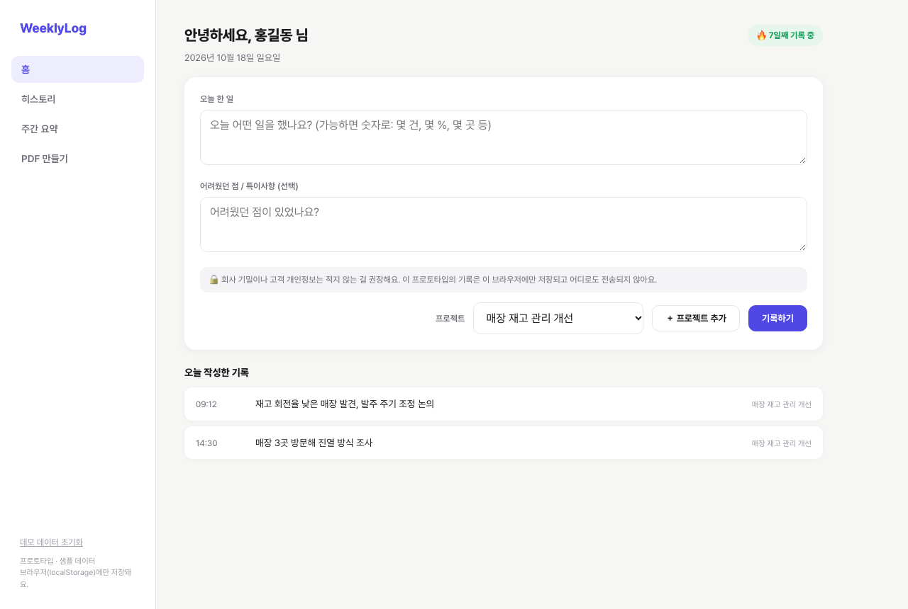
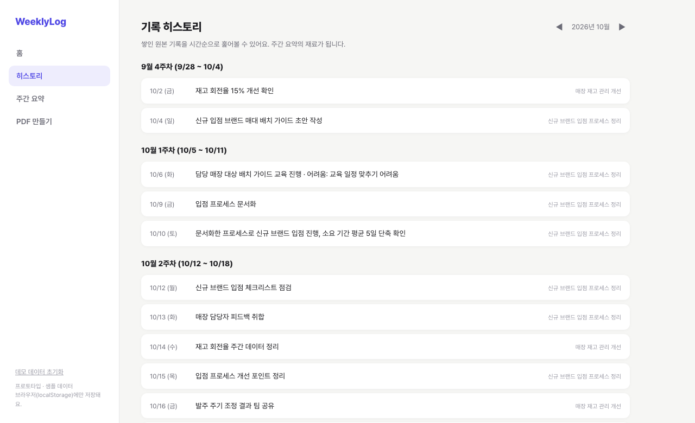
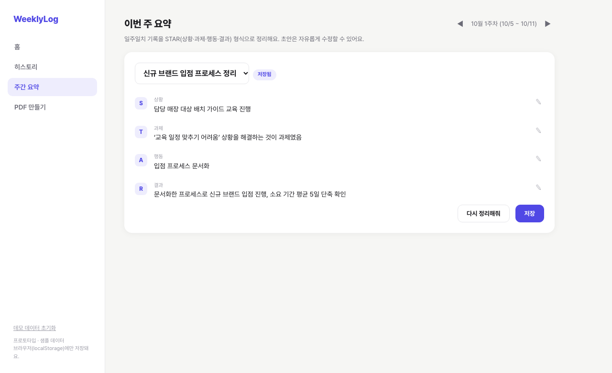
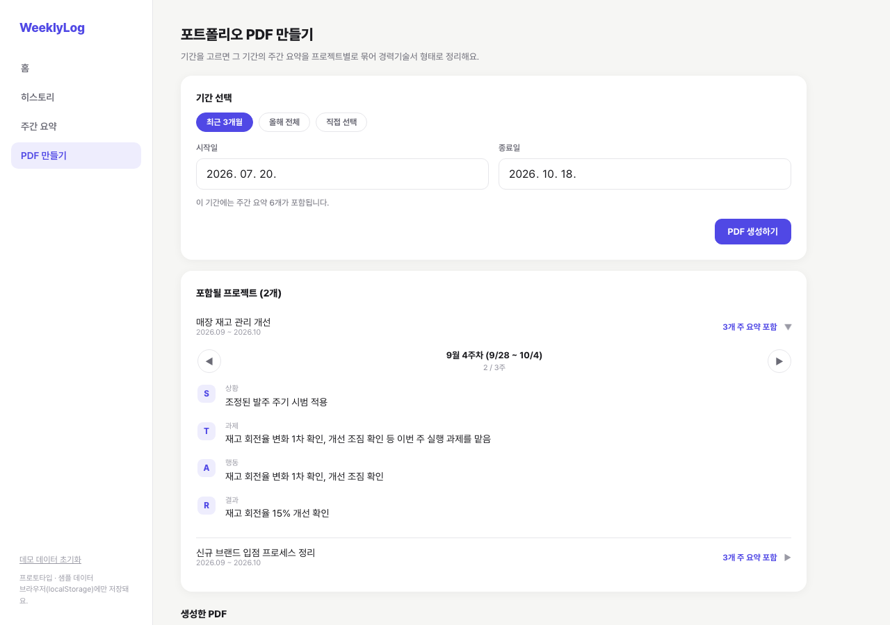
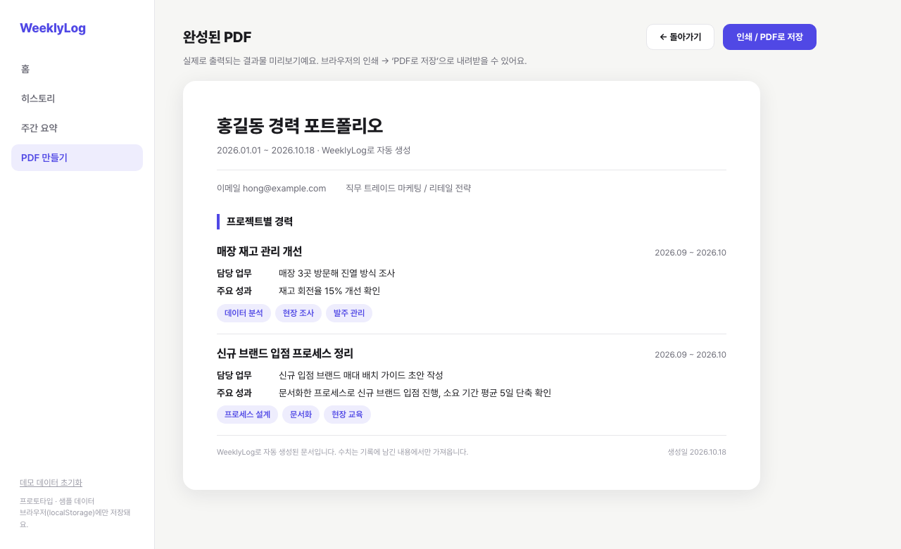

# WeeklyLog 프로토타입

> 매일 한 줄 기록으로 완성하는 이직 준비

**데모:** [GitHub Pages 링크 — 배포 후 기입]

매일 한 줄씩 한 일을 남기면 일주일치 기록을 STAR(상황·과제·행동·결과) 형식으로 정리하고, 이직 시즌에 원하는 기간을 골라 경력기술서 형태의 PDF로 만들어 주는 서비스의 **클릭해서 써 볼 수 있는 프로토타입**입니다. 서비스 기획과 Figma 화면 설계는 제가 했고, 구현은 Claude Code로 했습니다.

## 화면 구성

Figma로 설계한 5개 화면을 그대로 옮겼습니다.

| 홈 | 히스토리 | 주간 요약 |
|---|---|---|
|  |  |  |

| PDF 만들기 | 완성된 PDF |
|---|---|
|  |  |

## 실제로 동작하는 것 / 동작하지 않는 것

| 동작함 | 동작하지 않음 |
|---|---|
| 오늘 한 일 기록 추가 (필수 입력 검증), 새 프로젝트 추가, 연속 기록 일수 계산 | **AI 호출** — 주간 요약은 규칙 기반 샘플 로직입니다 |
| 주차별 히스토리, 월 이동 | 로그인·회원가입, 서버 저장 |
| 프로젝트별 주간 요약 생성, 문장별 수정, 저장, ‘다시 정리해줘’ | 마이페이지 (이번 범위에서 제외) |
| 기간 선택에 따른 포함 요약·프로젝트 집계, 프로젝트별로 펼쳐 주간 요약을 좌우 화살표로 넘겨 보기 | 영문 경력기술서, 템플릿 선택, 결제 |
| 완성된 PDF 미리보기와 인쇄(‘PDF로 저장’) | |

기록은 브라우저(localStorage)에만 저장됩니다. 샘플 데이터는 실행한 날짜를 기준으로 생성되며, 왼쪽 아래 ‘데모 데이터 초기화’로 되돌릴 수 있습니다.

## 주간 요약이 만들어지는 방식 (AI 없이)

실제 서비스에서는 AI가 기록을 STAR로 정리하겠지만, 이 프로토타입은 API를 호출하지 않습니다. 대신 같은 주·같은 프로젝트의 기록을 시간순으로 묶어 정해진 규칙으로 문장을 만듭니다. 첫 기록은 상황, ‘어려웠던 점’이 있으면 과제, 중간 기록은 행동, 마지막 기록은 결과로 배치합니다. ‘다시 정리해줘’는 다른 문장 구성(변형)으로 바꿔 줍니다.

**수치는 기록에 있는 것만 씁니다.** 결과에 %·일·건 같은 수치가 없으면 “정량화는 다음 주 기록에서 보완 예정”이라고 표시하고, PDF의 ‘주요 성과’도 사용자가 기록에 직접 남긴 수치가 있는 문장에서만 가져옵니다. Figma 설계에서는 주간 요약에 “정량화는 보완 예정”이라고 적혀 있었는데 완성된 PDF에는 “3주 내 15% 개선”이 들어 있어, AI가 기록에 없는 수치를 만들어 낸 것처럼 보일 수 있었습니다. 프로토타입에서는 이 불일치가 없도록 고쳤습니다.

## 만들면서 겪은 시행착오

- **‘다시 정리해줘’가 저장된 요약을 지워 버림.** 처음 구현에서는 다시 정리하기를 누르면 이미 저장해 둔 요약이 먼저 삭제됐습니다. 코드를 다시 읽다가 발견했고, 저장 전 초안만 바뀌고 저장본은 ‘저장’을 눌러야 바뀌도록 고쳤습니다.
- **‘3곳’을 성과로 착각함.** PDF의 주요 성과를 고를 때 숫자가 들어 있으면 정량 성과로 판단하게 했더니 “매장 3곳 방문해 진열 방식 조사”가 성과로 올라왔습니다. 브라우저에서 PDF 미리보기를 확인하다 발견했고, %·일·건·개월 등 결과 단위가 붙은 수치만 인정하도록 바꿨습니다.
- 확인은 헤드리스 Chrome에서 기록 추가 → 히스토리 → 요약 수정·저장 → PDF 생성까지의 시나리오를 돌리는 방식으로 했고, 콘솔 오류가 없는 것을 확인했습니다.

## 열린 질문 (만들면서 생긴 제품 판단)

**1. 연속 기록은 주말·연차를 어떻게 다룰까?**
지금은 달력 기준이라 하루만 빠져도 끊깁니다. 설문에서 8/10이 “매일 기록하는 게 귀찮을 것 같다”고 답했는데, 연속 기록이 오히려 부담이 되면 곤란합니다.
- 선택지: 달력 기준 / 평일 기준 / 쉬는 날 표시(연차·휴가를 사용자가 지정)
- 현재 판단: **평일 기준 + 쉬는 날 표시**. 주말은 기본으로 건너뛰고, 연차나 주말 근무는 사용자가 직접 바꿉니다. 검증 지표인 ‘무료 사용자의 4주 기록 유지율’에 직접 영향을 주는 규칙입니다.
- 상태: 프로토타입에는 아직 반영하지 않았습니다.

**2. 회사 정보 유출 걱정을 어떻게 줄일까?**
설문에서 4/10이 “회사 정보 유출이 걱정된다”고 답했습니다. “숫자로 적어 달라”는 서비스 방향과 “회사 수치는 민감하다”는 걱정이 부딪히는 지점입니다.
- 선택지: ① 입력창 안내 문구 ② 비식별 기록 유도(회사·고객 이름 대신 ‘A 매장’, 금액 대신 비율) ③ 데이터 처리 고지(서버 저장 여부, AI 전달 여부, 학습 사용 여부) ④ PDF 내보내기 전 검토 단계
- 현재 판단: **①과 ③을 먼저**. 실제 AI를 연결하면 기록이 외부로 전달되므로 ③은 필수입니다. ②는 서비스 방향과 충돌할 수 있어 더 설계가 필요합니다.
- 상태: ①은 홈 입력창 아래에 안내 문구로 반영했습니다. 이 프로토타입은 네트워크 요청이 없고 기록이 브라우저(localStorage)에만 저장됩니다. ②~④는 반영하지 않았습니다.

## 실행 방법

`index.html`을 브라우저로 열면 됩니다. 빌드나 서버가 필요 없습니다.

## 다음 단계

- 주간 요약과 경력기술서 생성에 실제 AI 연결 (결과에 수치가 없으면 만들어 내지 않도록 제약)
- 로그인·서버 저장, 마이페이지
- 설문(n=10)에서 나온 과제 반영: 기록 부담을 줄이는 리마인더, 정량화 유도 문구, 개인정보 안내
